# EmlakHub: Homes for Sale and Rent

Software project documentation · Afro-Asian Tech Forum 2026 · Software category

<p align="center"></p>


## 1. Project Overview | نظرة عامة على المشروع

| Field | Value |
|-------|-------|
| **Project Title** | EmlakHub: Homes for Sale and Rent |
| **Project Type** | Web application |
| **Description** | A real estate web app that makes it easy to search for properties and buy or rent them. Users browse the gallery, view each property's details, and prepare, download and upload their contracts. The admin adds properties and manages user data and the contract files uploaded by clients. |
| **Target Users** | <span class="ar" dir="rtl">مستخدمين يبحثون عن عقارات للبيع أو الإيجار، مالكون يريدون نشر عقاراتهم، ومستخدمين يريدون عرض تفاصيل كاملة عن العقار من حيث السعر والعنوان والعدد والمساحة.</span> |
| **Live app** | <https://my-new-project-emlakapp.streamlit.app/> |

### Tech Stack | التقنيات المستخدمة

| Category | Technology | Purpose |
|----------|-----------|---------|
| Language | Python | All the app's logic |
| Framework | Streamlit 1.64 | Web pages, forms, the role-based menu and session state |
| Database | SQLite (built into Python) | Users, listings, photos and contracts in `database/emlakhub.db` |
| Files | Folders in the project | Listing photos in `data/uploads/`, signed contracts in `data/contracts/`, blank contracts in `assets/documents/` |
| Styling | Streamlit's default theme | Cards, badges and one highlighted button per screen. No custom CSS. |

### Dependencies | المكتبات

| Package | Version | Purpose |
|---------|---------|---------|
| streamlit | 1.64.0 | The whole web interface. It is the only package in `requirements.txt`. |
| sqlite3 | Standard library | Talking to the database. Nothing to install. |
| os | Standard library | Saving and deleting photo and PDF files, and making their folders. |

## 2. Problem Statement | المشكلة

<p class="ar" dir="rtl">المشكلة الرئيسية هي صعوبة الوصول إلى معلومات العقارات بشكل منظم وسريع، خاصة عندما يحتاج العميل إلى البحث عن عقار مناسب وقراءة التفاصيل ثم متابعة الإجراءات مثل التعاقد. كما أن المالك يحتاج إلى منصة تمكنه من عرض عقاره بسهولة وبدون تعقيد.</p>

This project solves the problem of fragmented property searching and manual property management. Users can browse available houses and apartments and see details quickly through one online platform.

### Why does it matter? | لماذا هذا مهم؟

It matters because property buying, selling, and renting often require a clear presentation of information, trust, and organized documentation. EmlakHub simplifies the process and reduces time spent in searching and managing property records.

### How is it currently solved? | كيف تُحل المشكلة حاليًا؟

Today most people in Egypt find homes through brokers (simsar), Facebook groups, or big property websites. Listings are scattered across many places, prices and photos are often out of date, and the contract is still paperwork done in person.

## 3. Technical Architecture | البنية التقنية

### Project Structure | هيكل المشروع

```text
emlakhub/
├── app.py                       # Runs first every time: makes the tables, builds the menu for the logged-in person
├── app_pages/                   # The screens
│   ├── gallery.py               # Every listing, with search and four filters
│   ├── property_details.py      # One listing: photos, price, Sign button; admin tools
│   ├── contract.py              # Sign a contract: details, blank PDF, signed PDF
│   ├── my_contracts.py          # A user's contracts and their status
│   ├── log_in.py · sign_up.py · log_out.py
│   ├── add_property.py          # Admin: a new listing with 1–5 photos
│   ├── edit_property.py         # Admin: change a listing, add or remove photos
│   ├── users.py                 # Admin: everyone who signed up
│   └── contracts.py             # Admin: every contract, Approve or Reject
├── services/                    # Every function, one small file per topic
│   ├── database.py              # connect() and create_tables()
│   ├── user_service.py          # sign up, log in, list users
│   ├── property_service.py      # listings, filters, prices
│   ├── photo_service.py         # save, list and delete photos
│   └── contract_service.py      # save, approve and reject contracts
├── database/
│   ├── schema.sql               # The 4 tables
│   ├── seed.sql                 # The 51 starter listings and their photos
│   └── emlakhub.db              # The SQLite database the app uses
├── assets/documents/            # ownership_contract.pdf, tenant_contract.pdf
├── data/uploads/                # Listing photos
├── data/contracts/              # Signed contracts, contract_<id>.pdf
├── logo.png                     # The project logo
├── docs/                        # This documentation, the poster, the slides and the diagrams
└── requirements.txt             # streamlit==1.64.0
```

### Architecture and Data Flow | تدفق البيانات

```text
User's browser
    -> app.py (runs before every page)
        -> create_tables(): makes the 4 tables, adds the 51 starter listings if the gallery is empty
        -> reads st.session_state.user and builds the menu with st.navigation
        -> runs the chosen screen in app_pages/
            -> the screen calls a function in services/
                -> the function opens the database, runs plain SQL, commits and closes
```

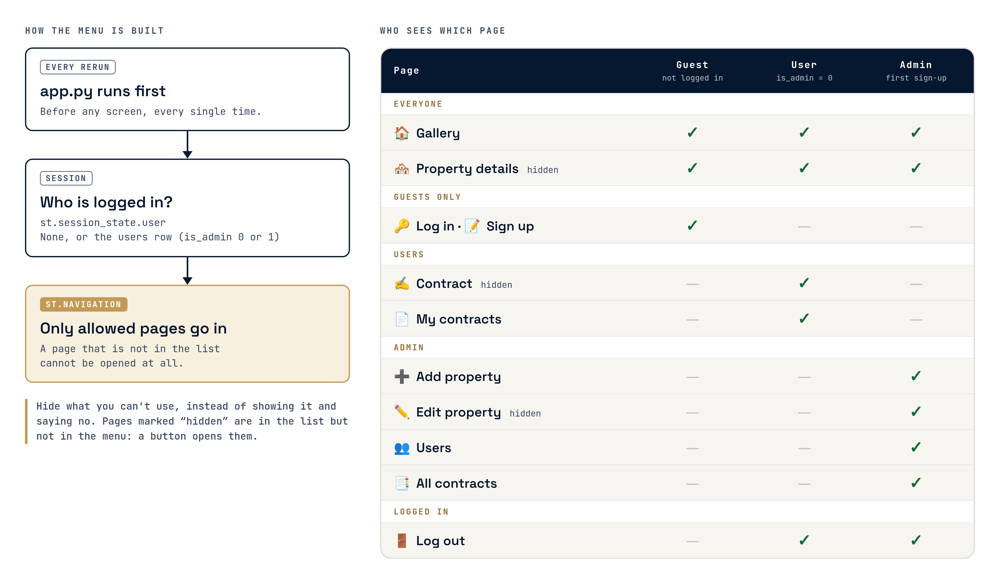

### Key Files | الملفات الأساسية

| File | Purpose |
|------|---------|
| `app.py` | Makes the tables, then decides which pages go in the menu for guests, users and the admin. Pages that aren't in the menu can't be opened. |
| `app_pages/contract.py` | Fills in the user's details, picks the ownership or tenant contract from the listing's offer, checks the 16-digit card number and the signed PDF, and saves the contract as pending. |
| `app_pages/contracts.py` | Shows waiting contracts first, with Approve and Reject buttons and the signed PDF. |
| `services/contract_service.py` | `approve_contract` marks the contract approved, marks the listing sold or rented, and rejects everyone else still waiting for it. |
| `services/property_service.py` | `get_properties` builds the gallery's SQL one filter at a time. `format_price` adds commas and "/ month" for rentals. |
| `database/schema.sql` | The 4 tables: `users`, `property`, `photos`, `contracts`. |

## 4. Features & User Flow | المميزات ورحلة المستخدم

### Feature List | قائمة المميزات

| # | Feature | Description | Status |
|---|---------|-------------|:------:|
| 1 | Gallery | Every listing as a card with its cover photo, a badge (For sale, For rent, SOLD or RENTED), price, address, rooms and area. Three cards per row. | Complete |
| 2 | Search and filters | Search the title or address, filter by sale or rent, type and minimum rooms. A max-price box appears after picking sale or rent. | Complete |
| 3 | Property details | Up to 5 photos, the description, the price (per month for rentals), type, address, rooms and area. | Complete |
| 4 | Accounts and roles | Sign up with name, email, phone, national ID and password. The first person to sign up is the admin. | Complete. Passwords are plain text (see Limits). |
| 5 | Sign a contract | Details filled in from the account, a 16-digit card number, the blank ownership or tenant PDF to download, and the signed PDF to upload (5 MB at most). | Complete. Nothing is paid. |
| 6 | My contracts | Each contract with its status: waiting, approved or rejected, and the signed PDF. | Complete |
| 7 | Contract approval | The admin approves or rejects. Approving marks the listing SOLD or RENTED and rejects everyone else waiting for it. | Complete |
| 8 | Manage listings | The admin adds listings with 1–5 photos, edits them, deletes them, and marks taken ones available again. | Complete |
| 9 | Users | The admin sees everyone who signed up. | Complete |

### User Flow | رحلة المستخدم

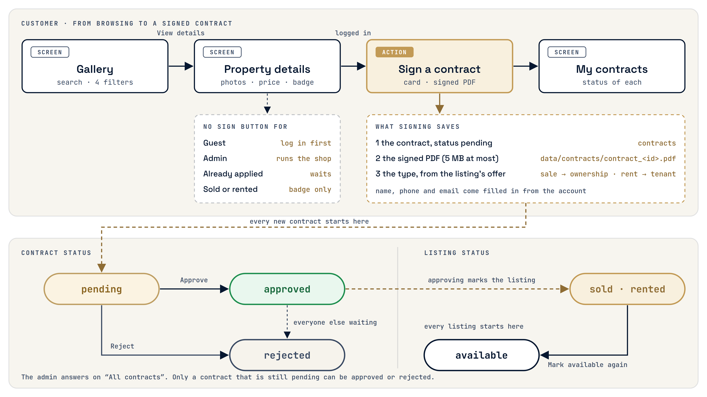

```text
Gallery (app_pages/gallery.py)
    -> View details -> Property details (app_pages/property_details.py)
        -> guest: "Log in or sign up to buy or rent this property"
        -> user: Sign a contract -> Contract (app_pages/contract.py)
            -> card number + signed PDF -> Save contract (status: pending)
                -> My contracts (app_pages/my_contracts.py)

Admin:
    All contracts (app_pages/contracts.py) -> Approve -> listing becomes sold or rented,
                                              everyone else waiting is rejected
                                           -> Reject
    Property details -> Edit property / Mark available again / Delete property
    Add property · Users
```

### Screen Reference | الشاشات

| Screen | File | Who sees it | Description |
|--------|------|-------------|-------------|
| Gallery | `app_pages/gallery.py` | Everyone | Search box, four filters and the listing cards. |
| Property details | `app_pages/property_details.py` | Everyone (opened from a card) | Photos and details. Users get "Sign a contract". The admin gets Edit, Mark available again and Delete. |
| Log in | `app_pages/log_in.py` | Guests | Email and password. |
| Sign up | `app_pages/sign_up.py` | Guests | Full name, email, phone, national ID, password. |
| Contract | `app_pages/contract.py` | Users (opened from a listing) | Three steps: your details, download and sign, upload. |
| My contracts | `app_pages/my_contracts.py` | Users | The user's contracts, newest first. |
| Add property | `app_pages/add_property.py` | Admin | Title, description, sale or rent, type, area, address, price, rooms, photos. |
| Edit property | `app_pages/edit_property.py` | Admin (opened from a listing) | The same fields filled in, and a Remove button for each photo. |
| Users | `app_pages/users.py` | Admin | A table of everyone who signed up, without passwords. |
| All contracts | `app_pages/contracts.py` | Admin | Every contract, waiting ones first, with Approve and Reject. |
| Log out | `app_pages/log_out.py` | Logged in | Clears the session and goes back to the guest menu. |

## 5. UI/UX Design | تصميم واجهة المستخدم

### Screenshots | لقطات الشاشة

<p align="center">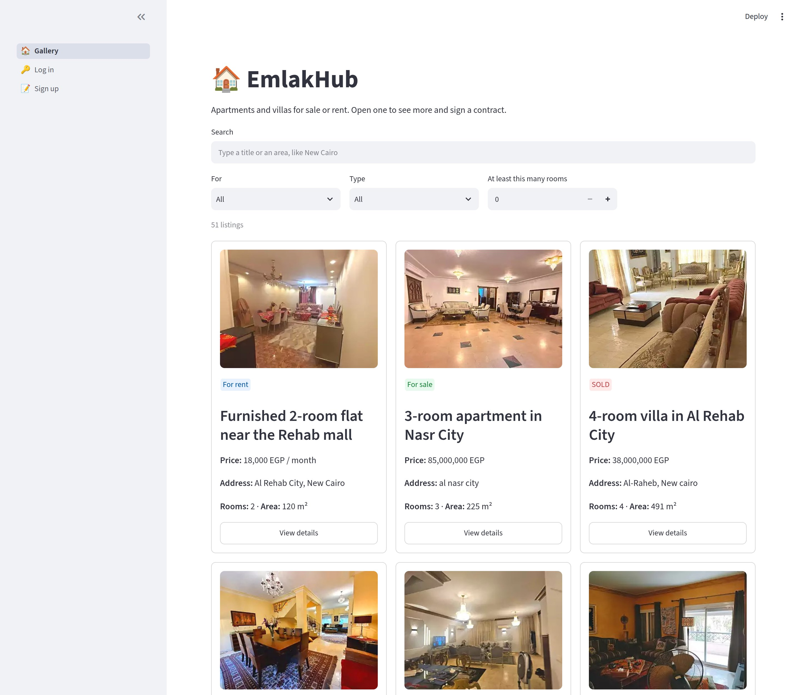</p>

| Search and filters | Property details |
|--------------------|------------------|
| 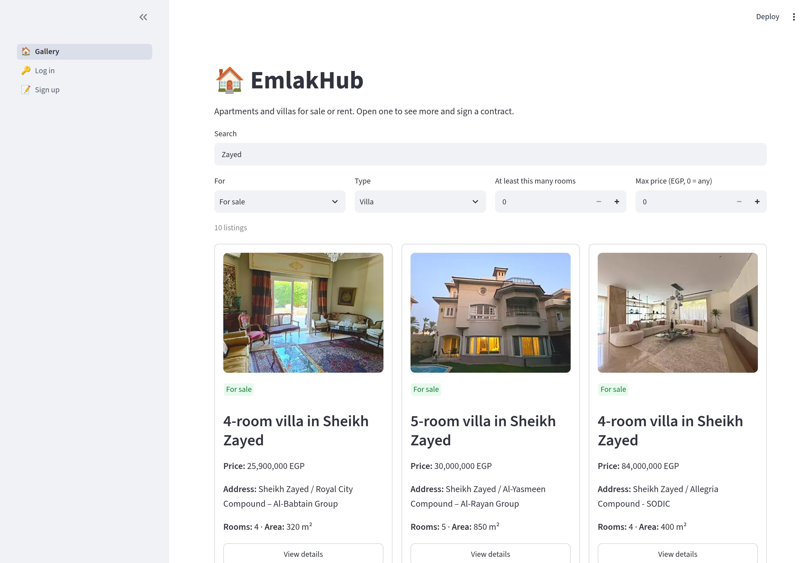 | 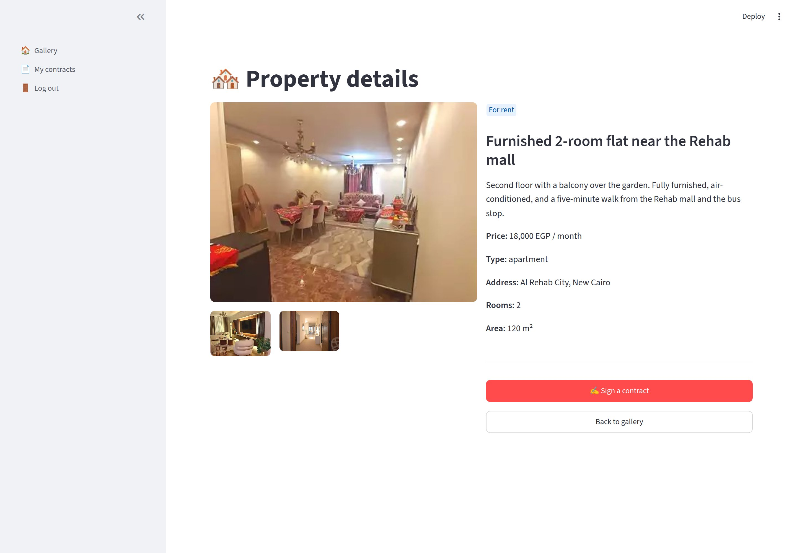 |

<p align="center">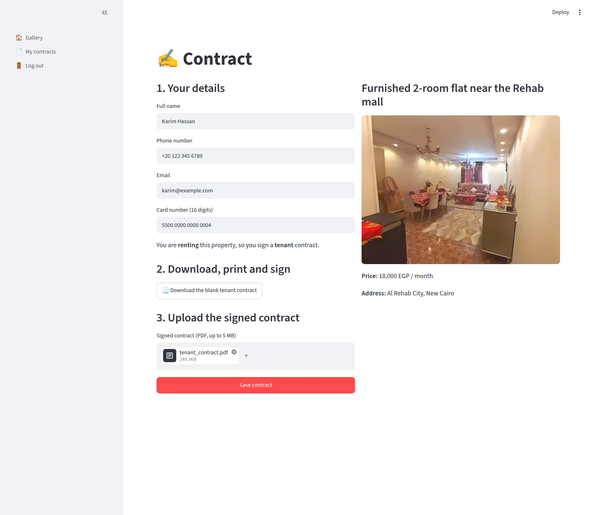</p>

| My contracts | All contracts (admin) |
|--------------|-----------------------|
| 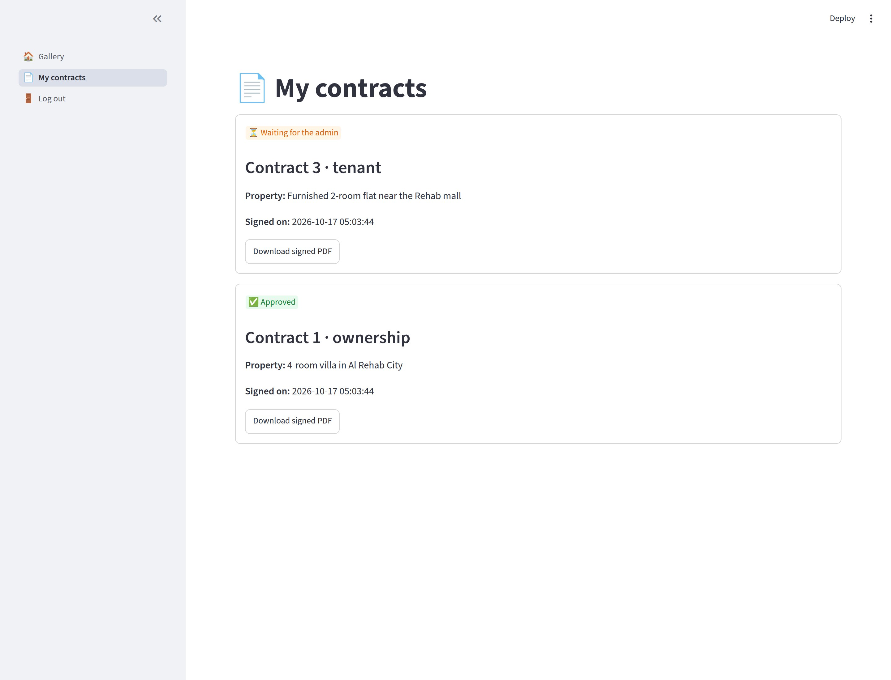 | 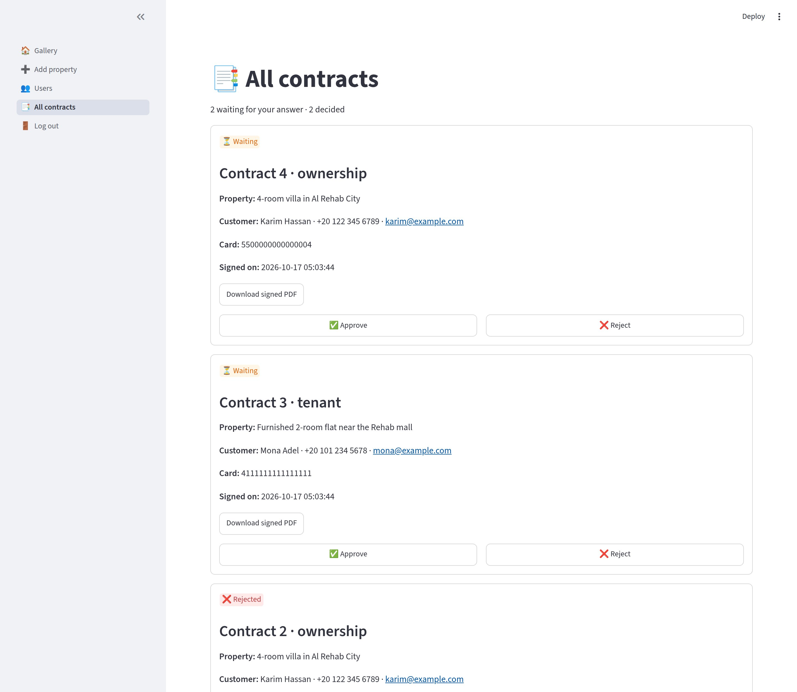 |

| Add property (admin) | Edit property (admin) |
|----------------------|-----------------------|
| 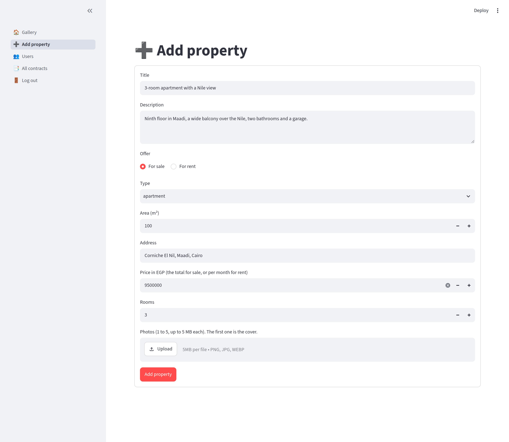 | 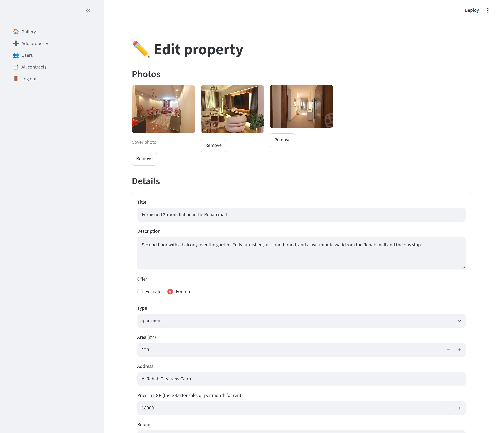 |

| Property details (admin) | Users (admin) |
|--------------------------|---------------|
| 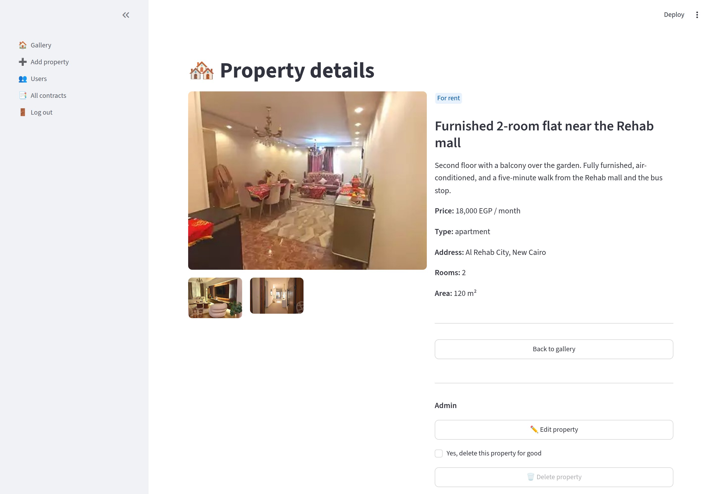 | 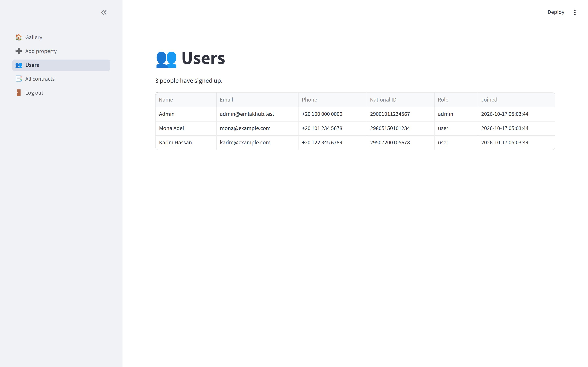 |

| Log in | Sign up |
|--------|---------|
| 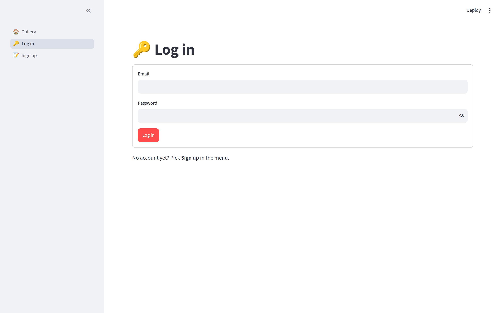 | 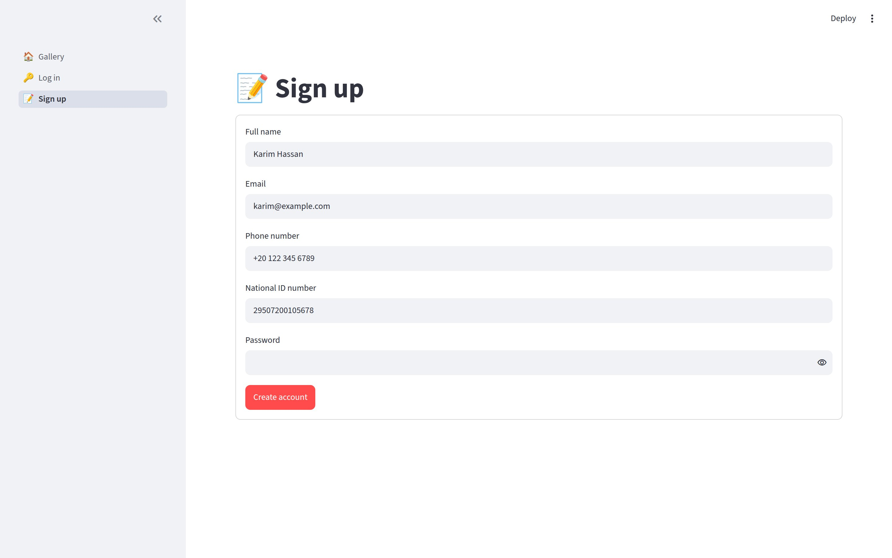 |

Try the app: <https://my-new-project-emlakapp.streamlit.app/>


### Design System | نظام التصميم

| Element | Current implementation |
|---------|------------------------|
| Logo | Gold "EH" letters in front of a city skyline with two small houses, above "EMLAK HUB" in Roman capitals, on deep navy (`logo.png`). The app itself shows 🏠 as its tab icon. |
| Brand colors | Logo navy `#061730` and gold `#C29A55` (from `#A8844D` to `#F7E6A6`). The poster, slides and diagrams use them. |
| App colors | Streamlit's default light theme, with its red primary button |
| Badges | Green "For sale", blue "For rent", red "SOLD", orange "RENTED", made with `st.badge` |
| Cards | `st.container(border=True)`, three per row in the gallery |
| Font | Streamlit's default font in the app. The poster and slides use Cinzel (like the logo), Space Grotesk and JetBrains Mono. |
| Buttons | One `type="primary"` button per screen for the main action |
| Layout | Wide pages, and a left menu that changes with the person's role |

## 6. Data Sources | مصادر البيانات

### Data Sources | مصادر البيانات

| Source | Type | Description |
|--------|------|-------------|
| Sign-up form | User input | Name, email, phone, national ID and password go into `users`. |
| Contract form | User input | Name, phone, email and card number go into `contracts`. The signed PDF goes into `data/contracts/`. |
| Admin forms | User input | New and edited listings, and their photos in `data/uploads/`. |
| `database/seed.sql` | Starter data | 51 listings for sale (27 apartments, 24 villas) in 7 areas around Cairo: Sheikh Zayed, Al Rehab City, Madinaty, El Shorouk, Fifth Settlement, Nasr City and 6th of October. Prices go from 3,200,000 to 85,000,000 EGP. Each listing has one photo. |
| `assets/documents/` | Files | The blank ownership and tenant contracts people download. |

### Database Schema | قاعدة البيانات

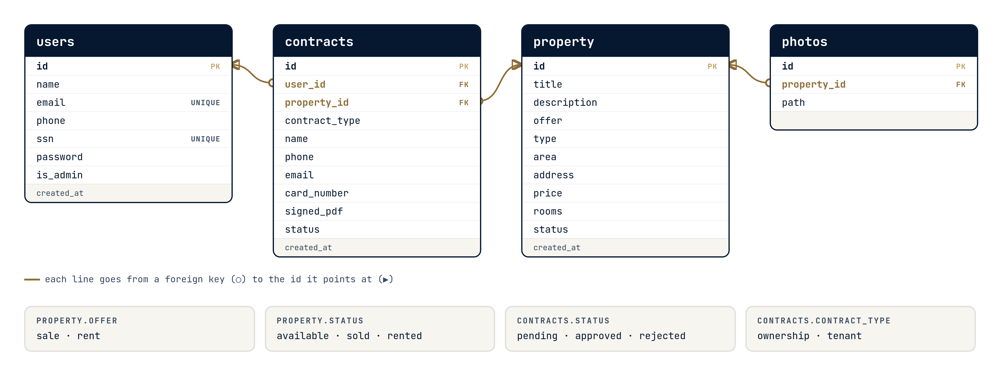

| Table | Columns | Description |
|-------|---------|-------------|
| `users` | `id`, `name`, `email`, `phone`, `ssn`, `password`, `is_admin`, `created_at` | Accounts. `email` and `ssn` are unique. The first one has `is_admin = 1`. |
| `property` | `id`, `title`, `description`, `offer`, `type`, `area`, `address`, `price`, `rooms`, `status`, `created_at` | Listings. `offer` is sale or rent, and `status` is available, sold or rented. |
| `photos` | `id`, `property_id`, `path` | 1 to 5 photos per listing. The oldest one is the cover. |
| `contracts` | `id`, `user_id`, `property_id`, `contract_type`, `name`, `phone`, `email`, `card_number`, `signed_pdf`, `status`, `created_at` | `contract_type` is ownership or tenant, and `status` is pending, approved or rejected. |

The lines in the diagram show which id each column points at. `schema.sql` doesn't declare them as foreign keys, because SQLite doesn't need them. The code keeps them in step.

### External APIs | الخدمات الخارجية

| API | Purpose | Rate Limit |
|-----|---------|------------|
| None | The app calls no outside service. Photos and PDFs are files in the project. | Not applicable |

### Limits | حدود المشروع

These shortcuts were taken on purpose to keep the code simple. The full list is in the README.

- Passwords, national IDs and card numbers are saved as plain text.
- Nothing is paid, and the card number only has to be 16 digits.
- The first person to sign up is the admin for good.
- Nobody checks the signed PDF, and no email is sent.
- A listing is either for sale or for rent, with one price.
- Listings, users and contracts on the live app are lost when it restarts or is redeployed.

## 7. Educational Content | المحتوى التعليمي

### Learning Objectives | أهداف التعلم

Through building this project, a student can practice:

1. Building a full web application using Python and Streamlit.
2. Designing and working with a SQLite database for storing real-world data.
3. Creating interactive forms for login, registration, and property listing.
4. Managing uploaded files such as property images and PDF contracts.
5. Building a complete user flow from browsing to property details and contract management.

### Cultural / Historical Context | السياق الثقافي

| Topic | Description |
|-------|-------------|
| Real estate access | The project connects to the real-life need for easier property discovery and digital contract handling. |
| Digital transformation | It teaches how local services can be improved through simple online systems. |

### Curriculum Alignment | الارتباط بالمنهج

| Skill Area | What the Student Practices |
|------------|---------------------------|
| Problem Solving | Identifying a real property-management problem and building a digital solution |
| Computational Thinking | Data modeling, database logic, and workflow design |
| Creativity | Interface design, layout design, and user-friendly visual structure |
| Collaboration | Working on separate app sections like login, gallery, and contracts |
| Technical Writing | Documenting app structure, features, and data flow |

## 8. Marketing Plan | خطة تسويقية

### Target Audience | الجمهور المستهدف

- **Primary:** Buyers, renters, and property seekers looking for housing options online
- **Secondary:** Property owners and landlords who want to list their properties
- **Tertiary:** Real-estate agents and students exploring digital property management tools

### Platforms | المنصات

- Web browser on desktop
- Web browser on mobile devices
- Local demo environment for presentation and testing

### Promotion Ideas | أفكار ترويجية

1. Present the app in a school or competition exhibition.
2. Share screenshots of the property gallery and contract form on social media.
3. Demonstrate the app live to potential users and property owners.
4. Use the project as a practical example of digital transformation in real estate.

## 9. Student Worksheet | ورقة عمل الطالب

### My Project Information | معلومات مشروعي

**Student Name:** Omar Hossam Hamissa  
**Academy:** Techno Future KFS  
**Project Title:** EmlakHub: Homes for Sale and Rent

### What is your project about? | عن ماذا يتحدث مشروعك؟

<p class="ar" dir="rtl">مشروعي هو موقع إلكتروني للعقارات يساعد المستخدمين على البحث عن العقارات وعرض تفاصيلها وإدارة بيانات العقود.</p>

### What problem does it solve? | ما المشكلة التي يحلها؟

<p class="ar" dir="rtl">يساعد المشروع في تنظيم عملية البحث عن العقار وتسهيل نشر العقارات وإدارة العمليات المتعلقة بالعقود بطريقة أسرع وأكثر وضوحا.</p>

### My Data | بياناتي

**Where does data come from?**

<p class="ar" dir="rtl">البيانات تأتي من نموذج المستخدم، وقاعدة البيانات المحلية، وملفات الصور أو العقود المرفوعة داخل المشروع.</p>

**What data is stored?**

<p class="ar" dir="rtl">يتم حفظ بيانات العقارات، وبيانات المستخدمين، وتفاصيل العقود، وصور العقارات المرفوعة.</p>

### What I Learned | ماذا تعلمت

1. **The hardest part:** competing with the other real estate websites.
2. **The most fun part:** designing the property gallery and adding the property details experience.
3. **One thing I would do differently:** I would organize the project into a cleaner modular structure with shared functions and better validation.

### Screenshot of My Project | لقطة من مشروعي

<p align="center"></p>

---

Omar Hossam Hamissa · Techno Future KFS · Afro-Asian Tech Forum · Software category · 2026
